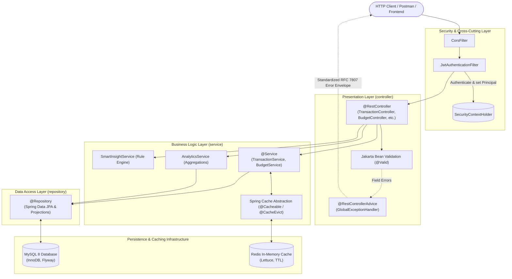
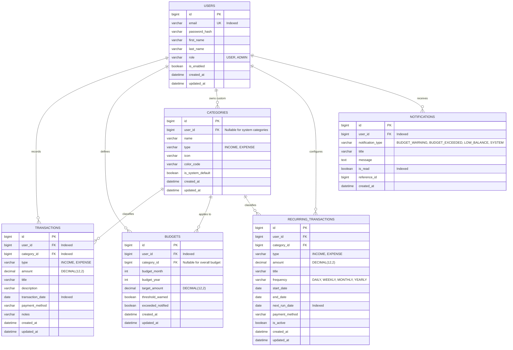

# 🪙 Smart Expense Tracker REST API

[](https://github.com/ankitaa1505/Smart-Expense-Splitter/actions)


A production-grade, secure, multi-tenant **Financial Expense & Budget Management REST API** built with **Java 21**, **Spring Boot 3.3.5**, **Spring Data JPA**, **MySQL 8**, **Redis**, and **Spring Security (JWT)**. Engineered with clean layered architecture, database migrations, in-memory caching with graceful fallbacks, scheduled automated jobs, rule-based spending insights, and Insecure Direct Object Reference (IDOR) prevention.

---

## 🌟 Key Highlights & Engineering Features

* **Multi-Tenant Row-Level Isolation (IDOR Defense)**: Every entity query, mutation, and aggregation is scoped strictly to the authenticated user's ID (`WHERE user_id = :userId`) extracted from verified JWT claims.
* **Monetary Precision with `BigDecimal`**: Uses `DECIMAL(12, 2)` in MySQL 8 and `java.math.BigDecimal` throughout Java services to eliminate IEEE 754 floating-point rounding errors.
* **Stateless Security (Spring Security 6 + JJWT 0.12.x)**: Short-lived HMAC-SHA256 access tokens, BCrypt password hashing (work factor 12), and custom `AuthenticationEntryPoint` returning RFC 7807 JSON errors.
* **Database Aggregations**: Category breakdowns, monthly spending trends, and balances computed via database-level SQL `SUM()`, `COUNT()`, and Spring Data JPA interface projections (`CategorySpendingProjection`, `MonthlySpendingProjection`), preventing in-memory collection bottlenecks.
* **Smart Redis Caching & Invalidation**: Cache-Aside implementation using Spring's `@Cacheable` and `@CacheEvict` for expensive analytics summaries. Includes custom `CacheErrorHandler` for **graceful degradation** (bypasses cache and queries MySQL directly if Redis goes offline).
* **Proactive Budget Monitoring**: Real-time spending tracking against overall and category-specific monthly budgets with automated **80% threshold warning** and **100% exceeded alert** notifications.
* **Automated Recurring Transactions**: Spring `@Scheduled` daemon running at `01:00 AM UTC` that checks due recurring schedules (Daily, Weekly, Monthly, Yearly), logs transactions, recalculates budgets, and notifies users.
* **Rule-Based Spending Insights & CSV Export**:
  * Anomaly detection flagging transactions $> 2.5\times$ higher than 90-day category averages.
  * Budget recommendations based on 3-month moving averages $+ 10\%$ buffer.
  * Low-balance warning notifications.
  * Fast CSV transaction export using Apache Commons CSV.

---

## 🏗️ Architecture & Request Flow



---

## 🗄️ Database Design & Entity Relationship Model

Schema evolution is governed via **Flyway migrations**:
* `V1__create_initial_schema.sql`: Tables, primary keys, foreign keys, and composite indexes.
* `V2__seed_default_categories.sql`: Seeds 16 system-default Expense and Income categories.



---

## 🛠️ Technology Stack Rationale

| Technology | Purpose | Why It Was Chosen |
| :--- | :--- | :--- |
| **Java 21 LTS** | Core Language | Virtual Threads readiness, modern Records for immutable DTOs, Pattern Matching, and strong performance. |
| **Spring Boot 3.3.5** | Framework | Production-ready ecosystem with auto-configuration, dependency management, and embedded Tomcat. |
| **MySQL 8** | Relational DB | ACID compliance, strict foreign key constraints, composite B-Tree indexes, and high consistency for financial records. |
| **Spring Data JPA & Hibernate** | ORM | Declarative queries, Spring Data Repository abstraction, JPA Specifications for dynamic search, and SQL projection support. |
| **Redis 7.4** | In-Memory Cache | Cache-aside for heavy dashboard aggregation queries, sub-millisecond response times, and customizable TTLs. |
| **Spring Security 6 + JJWT** | Security | Modern filter chain configuration, stateless JWT authentication, and BCrypt password encryption. |
| **Flyway** | Migrations | Eliminates dangerous Hibernate `ddl-auto=update` in production; version-controlled, reproducible database schemas. |
| **Docker & Compose** | Containerization | Multi-stage Dockerfile (build stage vs slim JRE runtime) and multi-container orchestration. |
| **Apache Commons CSV** | Data Export | High-performance CSV file streaming and download generation. |

---

## 📡 REST API Reference

Interactive OpenAPI documentation is accessible at:
🔗 `http://localhost:8080/swagger-ui.html`

### 1. Authentication (`/api/auth`)
* `POST /api/auth/register` — Register a new account (`201 Created`)
* `POST /api/auth/login` — Authenticate with email/password and obtain JWT access token (`200 OK`)
* `GET /api/users/me` — Fetch authenticated user profile (`200 OK`)

### 2. Categories (`/api/categories`)
* `GET /api/categories` — List available system and custom categories (`200 OK`)
* `POST /api/categories` — Create custom user category (`201 Created`)
* `DELETE /api/categories/{id}` — Delete custom category (`204 No Content`)

### 3. Transactions (`/api/transactions`)
* `POST /api/transactions` — Record new transaction (`201 Created`, with `Location` header)
* `GET /api/transactions/{id}` — Get single transaction details (`200 OK`)
* `PUT /api/transactions/{id}` — Update existing transaction (`200 OK`)
* `DELETE /api/transactions/{id}` — Delete transaction (`204 No Content`)
* `GET /api/transactions` — Multi-filter search (type, category, date range, search query) with sorting and pagination (`200 OK`)
* `GET /api/transactions/export` — Download filtered transactions as CSV (`200 OK`)

### 4. Budgets (`/api/budgets`)
* `POST /api/budgets` — Create category or overall monthly budget (`201 Created`)
* `GET /api/budgets?month={m}&year={y}` — List budgets with utilization % and warning statuses (`200 OK`)
* `GET /api/budgets/{id}` — Get budget details (`200 OK`)
* `PUT /api/budgets/{id}` — Update budget target amount (`200 OK`)
* `DELETE /api/budgets/{id}` — Delete budget (`204 No Content`)

### 5. Financial Analytics (`/api/analytics`)
* `GET /api/analytics/summary` — Cached dashboard summary (income, expense, net balance, savings rate %, daily average) (`200 OK`)
* `GET /api/analytics/categories` — Category spending breakdown with percentages (`200 OK`)
* `GET /api/analytics/monthly` — Monthly income and expense trends over time (`200 OK`)
* `GET /api/analytics/mom` — Month-over-Month (MoM) spending comparison (`200 OK`)
* `GET /api/analytics/insights` — Rule-based anomaly alerts, budget recommendations, and low-balance check (`200 OK`)

### 6. Recurring Schedules & Notifications
* `POST /api/recurring` — Set up recurring schedule (`201 Created`)
* `GET /api/recurring` — List user's recurring schedules (`200 OK`)
* `PATCH /api/recurring/{id}/toggle` — Activate / pause recurring schedule (`200 OK`)
* `GET /api/notifications` — View paginated budget warnings and alerts (`200 OK`)
* `GET /api/notifications/unread` — List unread alerts (`200 OK`)
* `PATCH /api/notifications/{id}/read` — Mark alert as read (`200 OK`)

---

## 🚀 Local Setup & Running Instructions

### Prerequisites
* **Java 21 LTS**
* **Apache Maven 3.9+**
* **MySQL 8** & **Redis** (Local or via Docker)

### Option 1: Running with Local MySQL and Redis
1. Copy `.env.example` to `.env` and configure your credentials:
   ```powershell
   cp .env.example .env
   ```
2. Start the application:
   ```powershell
   mvn spring-boot:run
   ```
3. The server starts on `http://localhost:8080`. Flyway automatically runs database migrations upon startup.

### Option 2: Running with Docker Compose
To run MySQL and Redis in containers:
```powershell
# Start MySQL 8 and Redis 7.4 in background
docker compose up -d mysql redis

# Check container health status
docker compose ps

# Shutdown containers
docker compose down
```

To run the full stack (including the Spring Boot application container):
```powershell
docker compose --profile full-stack up --build -d
```

---

## 🧪 Testing & Verification

The project includes unit, repository, and integration tests across security, transactions, budgets, analytics, recurring schedules, and IDOR protection.

Run the test suite:
```powershell
mvn clean test
```

### Test Coverage Highlights:
* **`SecurityIntegrationTest`**: Verifies unauthenticated access returns `401 Unauthorized` and Swagger UI is public.
* **`DataIsolationIntegrationTest`**: Verifies User A cannot read or delete User B's transactions or budgets.
* **`BudgetServiceTest`**: Validates 80% warning triggers, 100% exceeded triggers, and duplicate budget prevention.
* **`AnalyticsServiceTest`**: Tests savings rate calculation, daily spending averages, and MoM changes.
* **`RecurringTransactionServiceTest`**: Validates next run date computation (Daily, Weekly, Monthly, Yearly) and scheduled transaction creation.

---

## 📮 Postman Collection

A Postman collection is included in [`postman/SmartExpenseTracker.postman_collection.json`](file:///C:/JavaApps/SmartExpenseTracker/postman/SmartExpenseTracker.postman_collection.json).
1. Open Postman $\rightarrow$ Click **Import**.
2. Select `postman/SmartExpenseTracker.postman_collection.json`.
3. Execute **Login (Authenticate & Get Token)**: The test script automatically saves the `accessToken` into the collection variable `{{token}}`, authorizing all subsequent requests automatically!

---

## 📄 License
This project is open-source and available under the [MIT License](LICENSE).
